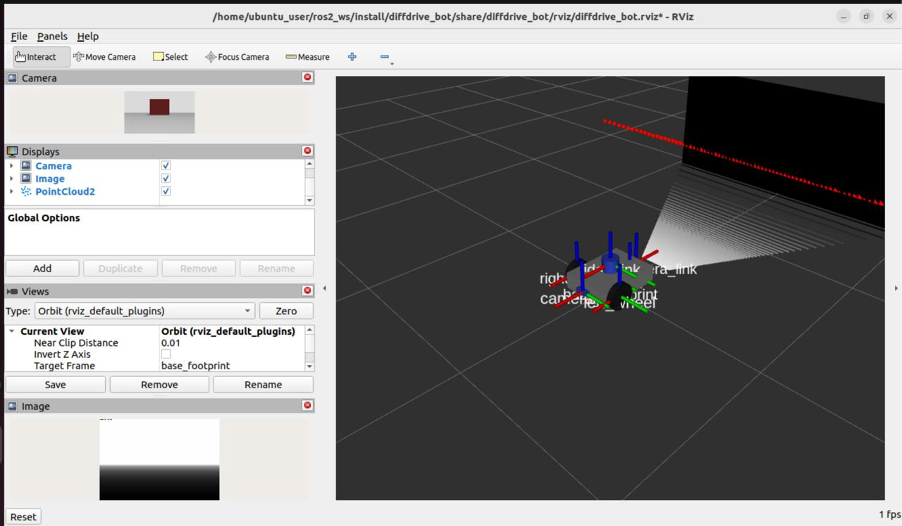
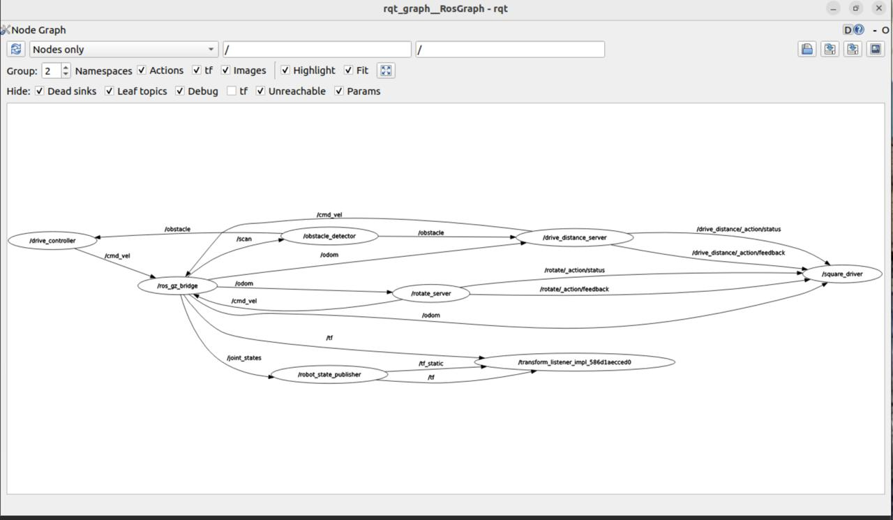

# Lab 1 exercise

My solution to the Lab 1 exercise (ROS 2 Humble, Gazebo Harmonic). This folder holds four packages:

| Package | Build type | What it holds |
|---------|------------|---------------|
| `diffdrive_bot` | ament_cmake | The robot, now with a depth camera and an IMU (Step 1) |
| `lab_interfaces` | ament_cmake | The lab's own message, service and action types |
| `my_robot_interfaces` | ament_cmake | My `RobotStatus` message, `SetTurnSpeed` service and `Rotate` action |
| `my_robot_nodes` | ament_python | My nodes `turn_away`, `rotate_server`, `square_driver` and `square.launch.py` |

## Build

Put this folder in the `src` folder of a workspace, then:

```bash
cd ~/ros2_ws
colcon build --symlink-install
source install/setup.bash
```

Run `source install/setup.bash` in every new terminal.

## Step 1: depth camera and IMU

```bash
ros2 launch diffdrive_bot gazebo.launch.py
ros2 topic list | grep -E "depth|imu"
ros2 topic hz /imu
```

In RViz add an Image display for `/depth_camera/image` and a PointCloud2 display for `/depth_camera/points`.

## Steps 2 to 5: the `turn_away` node

Start the robot, then the node in a second terminal:

```bash
ros2 launch diffdrive_bot control.launch.py
ros2 run my_robot_nodes turn_away
```

The node starts switched off (Step 5), so switch it on first:

```bash
ros2 service call /turn_away_enable std_srvs/srv/SetBool "{data: true}"
```

- **Step 2:** the robot drives forward and turns away from the obstacle in front of it.
- **Step 3:** change a parameter while it drives: `ros2 param set /turn_away forward_speed 0.4`
- **Step 4:** `ros2 interface show my_robot_interfaces/msg/RobotStatus` and `ros2 topic echo /robot_status`
- **Step 5:** `ros2 service call /set_turn_speed my_robot_interfaces/srv/SetTurnSpeed "{turn_speed: 1.0}"` is accepted, and a speed of 3.0 is rejected. Switch off with `ros2 service call /turn_away_enable std_srvs/srv/SetBool "{data: false}"`.

## Step 6: `rotate_server`

```bash
ros2 launch diffdrive_bot control.launch.py
ros2 run my_robot_nodes rotate_server
ros2 action send_goal --feedback /rotate my_robot_interfaces/action/Rotate "{angle: 1.57}"
```

A goal of 0 is rejected, and canceling a goal stops the robot.

## Step 7: drive a square

```bash
ros2 launch my_robot_nodes square.launch.py side_length:=0.8
```

This starts the simulation, the diffdrive_bot nodes, `rotate_server` and `square_driver`. The robot drives four sides and turns a quarter turn left after each. The square fits up to 1 m a side from the start position.

## Screenshots

Depth image and point cloud (Step 1):



`rqt_graph` while `square.launch.py` runs:



## What did not work

- The simulation ran slowly in my virtual machine (Gazebo showed about 14 % of real time), so the robot reacted slowly and goals took a long time. Waiting for Gazebo to load fully before sending commands fixed most problems.
- Pasting Python code into the editor lost its indentation, which gave an `IndentationError` in `turn_away.py`. I fixed it by replacing the whole file instead of editing part of it.
- `turn_away` failed with `No module named 'my_robot_interfaces'` after I added the message. The message package must be built, and the workspace sourced in a new terminal, before the node can import it.
- The first `git push` failed because GitHub does not accept an account password for Git. I made a personal access token and used that as the password.
